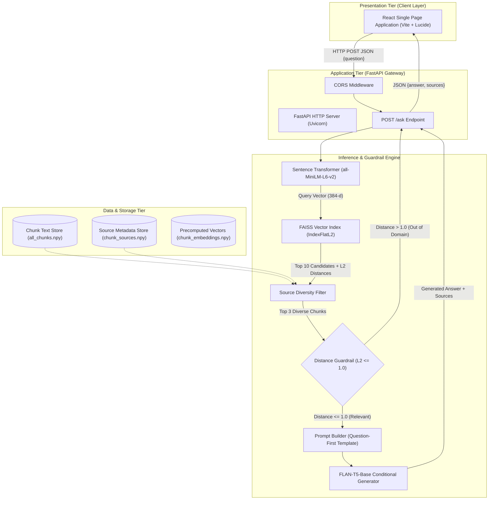
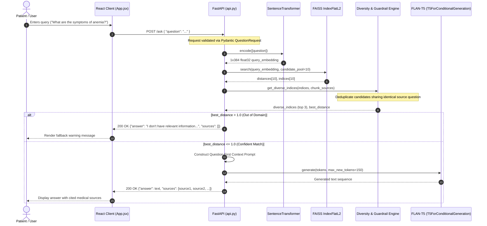

# MedRAG — AI Medical Question-Answering Assistant

[](https://fastapi.tiangolo.com/)
[](https://react.dev/)
[](https://huggingface.co/google/flan-t5-base)
[](https://github.com/facebookresearch/faiss)
[](https://www.sbert.net/)

MedRAG is an end-to-end, production-grade **Retrieval-Augmented Generation (RAG)** system engineered to answer complex medical questions. It pairs semantic document retrieval from authoritative National Institutes of Health (NIH) literature with generative language modeling, backed by safety guardrails that prevent hallucinated medical guidance.

---

## Table of Contents

- [Motivation & Core Philosophy](#motivation--core-philosophy)
- [Key Features](#key-features)
- [High-Level Architecture (HLD)](#high-level-architecture-hld)
  - [System Context & Tiered Topology](#system-context--tiered-topology)
  - [Core Subsystems](#core-subsystems)
- [Low-Level Architecture (LLD)](#low-level-architecture-lld)
  - [End-to-End Sequence & Data Flow](#end-to-end-sequence--data-flow)
  - [Data Ingestion & Chunking Pipeline](#data-ingestion--chunking-pipeline)
  - [Vector Search & Diversity Ranking Algorithm](#vector-search--diversity-ranking-algorithm)
  - [Confidence Threshold & Hallucination Guardrail](#confidence-threshold--hallucination-guardrail)
  - [Context-Truncation Safeguard & Prompt Assembly](#context-truncation-safeguard--prompt-assembly)
  - [API Interface Specifications](#api-interface-specifications)
- [Evaluation & Benchmarks](#evaluation--benchmarks)
- [Engineering Challenges & Bug Fixes](#engineering-challenges--bug-fixes)
- [Project Directory Layout](#project-directory-layout)
- [Getting Started](#getting-started)
  - [Prerequisites](#prerequisites)
  - [Backend Setup](#backend-setup)
  - [Frontend Setup](#frontend-setup)
- [Known Limitations & Future Roadmap](#known-limitations--future-roadmap)
- [Medical Disclaimer](#medical-disclaimer)

---

## Motivation & Core Philosophy

Large Language Models (LLMs) trained on generalized web corpora suffer from **hallucination**—confidently articulating fabricated claims, inaccurate pharmacological details, or obsolete clinical guidance. In healthcare, ungrounded outputs present serious hazards.

MedRAG addresses this through three fundamental design principles:
1. **Strict Contextual Grounding:** Answers are generated strictly from retrieved, peer-reviewed clinical knowledge (MedQuAD/NIH).
2. **Defensive Rejection (Zero-Guessing Fallback):** When the query lies outside the knowledge base or retrieval distance exceeds empirical safety thresholds, the system explicitly refuses to answer rather than speculating.
3. **Transparent Provenance:** Every response returns the source references used during generation, giving users complete traceability back to the clinical literature.

---

## Key Features

- **Dense Semantic Retrieval:** Embeds patient queries and clinical documents into 384-dimensional dense vectors using `sentence-transformers/all-MiniLM-L6-v2`.
- **Fast Similarity Search:** Powered by Meta's FAISS (`IndexFlatL2`) for sub-millisecond nearest-neighbor lookups across 20,000+ indexed clinical passages.
- **Source Diversity Filtering:** Avoids duplicate chunks from the same source document crowding out diverse clinical perspectives.
- **Euclidean Distance Guardrail ($d \le 1.0$):** Automatically deflects out-of-domain and low-confidence prompts.
- **Inverted Prompt Template Structure:** Places the query before the retrieved context to guarantee query survival even under strict token truncation constraints.
- **Interactive Single-Page UI:** Built with React 18, Vite, and Lucide Icons, featuring live chat states, source citations, error boundaries, and medical disclaimers.

---

## High-Level Architecture (HLD)

The system is organized into three tiers: **Client Layer**, **Application & API Gateway**, and **Retrieval & Inference Pipeline**, accompanied by an **Offline Ingestion Pipeline**.

### System Context & Tiered Topology



### Core Subsystems

1. **Presentation Tier (React Frontend):**
   - Provides a conversational chat interface with real-time feedback, loading states, error handling, and expandable source citations.
   - Enforces medical disclaimers on every interaction.

2. **Application Tier (FastAPI Service):**
   - High-throughput asynchronous REST API exposing health (`GET /`) and query (`POST /ask`) endpoints.
   - Single-instance in-memory warm loading: models and vector indexes are loaded into RAM once upon server startup to eliminate per-request cold-start latency.

3. **Retrieval & Guardrail Tier:**
   - Translates incoming natural language queries into 384-dimensional dense vectors.
   - Retrieves candidates via exact Euclidean distance ($L_2$) search, applies diversity filtering, and executes distance threshold verification.

4. **Inference Tier (FLAN-T5):**
   - Sequence-to-sequence conditional text generation fine-tuned on instruction tasks, conditioned solely on retrieved clinical chunks.

5. **Storage & Ingestion Pipeline:**
   - Offline batch pipeline that ingests raw MedQuAD Q&A pairs, filters short/degenerate entries, partitions documents into ~300-word segments, and serializes index arrays.

---

## Low-Level Architecture (LLD)

### End-to-End Sequence & Data Flow



---

### Data Ingestion & Chunking Pipeline

The data pipeline processes the **MedQuAD (Medical Question Answering Dataset)** sourced from 12 NIH institutes.

```
Raw MedQuAD Dataset (16,407 Q&A Pairs)
         │
         ▼
[Quality Filter] ──▶ Reject answers < 5 words (removes corrupted/empty rows)
         │
         ▼
16,400 Clean Pairs
         │
         ▼
[Sliding Chunking Engine] ──▶ Window: 300 words, Non-overlapping
         │
         ▼
20,612 Passage Chunks + Source Metadata Mapping
         │
         ▼
[Batch Encoding] ──▶ SentenceTransformer ('all-MiniLM-L6-v2')
         │
         ▼
Numpy Serialized Artifacts:
  - all_chunks.npy       (20,612 string objects)
  - chunk_sources.npy    (20,612 source question mappings)
  - chunk_embeddings.npy (20,612 x 384 float32 matrix)
```

- **Chunk Granularity:** Natural answers range up to 4,281 words. A fixed 300-word partition preserves coherent medical paragraphs without exhausting downstream context budgets.
- **Provenance Linkage:** Each chunk retains a pointer to the original parent question (`chunk_sources`), enabling attribution back to the primary clinical topic.

---

### Vector Search & Diversity Ranking Algorithm

Standard nearest-neighbor searches often return redundant passages from the same long document that were partitioned into adjacent chunks. MedRAG incorporates a **Diversity Filter**:

```python
def get_diverse_indices(question, top_k=3, candidate_pool=10):
    query_embedding = embed_model.encode([question])
    distances, indices = index.search(query_embedding, candidate_pool)
    
    seen_sources = set()
    diverse_indices = []
    for idx in indices[0]:
        source = chunk_sources[idx]
        if source not in seen_sources:
            seen_sources.add(source)
            diverse_indices.append(idx)
        if len(diverse_indices) >= top_k:
            break
    return diverse_indices, distances[0][0]
```

1. Retrieve an expanded candidate pool of $K=10$ nearest chunks.
2. Iterate through candidates and verify whether their originating parent source has already been selected.
3. Keep only the highest-ranking chunk per unique source until `top_k=3` is satisfied.
4. Prevents repetitive text from saturating the generative context window.

---

### Confidence Threshold & Hallucination Guardrail

When users ask questions outside the clinical domain (e.g., *"What is the capital of France?"* or *"How do I fix a carburetor?"*), traditional vector search still returns the nearest vectors in the corpus, even if semantically irrelevant.

MedRAG computes the Euclidean ($L_2$) distance between the query vector $q$ and the top candidate vector $c_0$:

$$d(q, c_0) = \sqrt{\sum_{i=1}^{384} (q_i - c_{0,i})^2}$$

Through empirical testing across in-domain and out-of-domain sets:
- **Relevant Medical Queries:** Typical $L_2$ distance ranges between **$0.35$ and $0.65$**.
- **Out-of-Domain Queries:** Typical $L_2$ distance ranges between **$1.35$ and $1.65$**.

```
Distance d:
0.0 --------- 0.65 ------------------ 1.00 ----------------------- 1.50+
[ Strong In-Domain Match ]       [ CUTOFF ]       [ Out-of-Domain / Reject ]
   Proceed to Generation                          Return Safe Fallback Notice
```

If $d(q, c_0) > 1.0$, the API immediately terminates inference and responds with:
> *"I don't have relevant information to answer that question confidently."*

---

### Context-Truncation Safeguard & Prompt Assembly

The generator model (`google/flan-t5-base`) has a maximum context capacity of 512 tokens. Placing retrieved context ahead of the user query risks truncating the question itself when context passages are long.

MedRAG uses an **Inverted Prompt Layout**:

```
Question: {question}

Answer the question using only the context below.

Context:
{retrieved_chunk_1}

{retrieved_chunk_2}

{retrieved_chunk_3}

Answer:
```

Because tokenizers process sequences from left to right, placing the question and the instruction directive at index 0 guarantees that the query and grounding constraints survive any tail truncation.

---

### API Interface Specifications

#### 1. System Health Check
- **Endpoint:** `GET /`
- **Response:**
  ```json
  {
    "status": "Medical RAG API is running"
  }
  ```

#### 2. Question Answering
- **Endpoint:** `POST /ask`
- **Request Headers:** `Content-Type: application/json`
- **Request Schema:**
  ```json
  {
    "question": "What causes iron deficiency anemia?"
  }
  ```
- **Success Response (`200 OK` - In Domain):**
  ```json
  {
    "answer": "Iron deficiency anemia is caused by blood loss, poor diet, or an inability to absorb iron from food.",
    "sources": [
      "What are the causes of Iron-Deficiency Anemia ?",
      "What is (are) Iron-Deficiency Anemia ?"
    ]
  }
  ```
- **Fallback Response (`200 OK` - Out of Domain / Low Confidence):**
  ```json
  {
    "answer": "I don't have relevant information to answer that question confidently.",
    "sources": []
  }
  ```

---

## Evaluation & Benchmarks

The retrieval mechanism was evaluated on an automated test harness of 100 randomly sampled questions drawn from the MedQuAD corpus using a fixed seed (`seed=42`):

| Evaluation Metric | Accuracy@3 | Description & Rationale |
|---|---|---|
| **Strict Accuracy@3** | **52.0%** (52/100) | Requires retrieval of the *exact* identical chunk ID that originated the query. |
| **Relaxed Semantic Accuracy@3** | **80.0%** (80/100) | Validates whether retrieved chunks share cosine semantic similarity $\ge 0.6$ with the target answer embedding. |

### Error Analysis & The Lexical Gap

Manual inspection of strict "failures" demonstrated that the strict metric frequently penalizes valid clinical answers:
- **Example:** For a query regarding *prognosis and complications* of a rare genetic disease, retrieval returned chunks describing *clinical treatments* and *pathophysiology* for the exact same condition.
- While marked as a miss by strict ID matching, the retrieved content provided contextually accurate clinical information. The relaxed metric accurately captures this clinical utility.

---

## Engineering Challenges & Bug Fixes

| Issue Encountered | Root Cause | Architectural Resolution |
|---|---|---|
| **Silent Query Truncation** | Prompts formatted as `Context + Question` exceeded FLAN-T5's 512-token limit, discarding the query at the tail. | Re-engineered prompt template to place `Question` and instructions first; restricted retrieval to top-3 diverse chunks. |
| **Out-of-Domain Hallucination** | When given queries like *"What is the tallest mountain in the world?"*, the model ignored irrelevant retrieved passages and hallucinated from pre-training memory. | Added Euclidean distance thresholding ($d \le 1.0$) prior to generation; returns immediate fallback response. |
| **Chunk Clustering Redundancy** | Long clinical documents split into multiple chunks dominated top retrieval slots, crowding out distinct clinical perspectives. | Developed greedy diversity filtering using candidate pool $K=10$ with source-level deduplication. |
| **Slow Per-Request Latency** | Loading models and FAISS indexes inside the request handler caused seconds of latency per invocation. | Shifted embedding and generation models into global process memory during FastAPI startup lifecycle. |

---

## Project Directory Layout

```
medrag/
├── api.py                    # FastAPI service with routing, guardrails, & generation
├── chunk_data.py             # Data ingestion, text chunking, and embedding generation
├── search.py                 # Standalone FAISS index builder & similarity search tester
├── generater.py              # CLI interactive RAG loop with generation pipeline
├── evaluate.py               # Benchmark test harness (Strict & Relaxed Accuracy@3)
├── load_data.py              # Dataset exploration and statistical profile script
├── explore_embeddings.py     # Vector geometry and cosine similarity exploratory script
├── requirements.txt          # Python runtime dependencies
├── .gitignore                # Git exclusion rules for large datasets, venv, and builds
├── README.md                 # Project architecture documentation
│
├── all_chunks.npy            # Serialized text chunks (generated via chunk_data.py)
├── chunk_embeddings.npy      # Serialized 384-d vectors (generated via chunk_data.py)
├── chunk_sources.npy         # Serialized source metadata (generated via chunk_data.py)
│
└── frontend/                 # React 18 + Vite Web Application
    ├── package.json          # Node.js dependencies and scripts
    ├── vite.config.js        # Vite bundler configuration
    ├── index.html            # HTML entry point
    └── src/
        ├── App.jsx           # Main chat interface component
        ├── index.css         # Styling and design system
        └── main.jsx          # React DOM root render
```

---

## Getting Started

### Prerequisites

- **Python:** 3.10 or higher
- **Node.js:** v18.0.0 or higher
- **RAM:** Minimum 8 GB recommended for loading model checkpoints and vector indexes.

---

### Backend Setup

1. **Clone the repository:**
   ```bash
   git clone https://github.com/krithika0609/Med-drug.git
   cd Med-drug
   ```

2. **Create and activate a virtual environment:**
   ```bash
   # Windows (PowerShell)
   python -m venv venv
   .\venv\Scripts\Activate.ps1

   # Linux / macOS
   python3 -m venv venv
   source venv/bin/activate
   ```

3. **Install dependencies:**
   ```bash
   pip install -r requirements.txt
   ```

4. **Data & Embeddings Ingestion:**
   If running for the first time without `.npy` files:
   ```bash
   python chunk_data.py
   ```
   *This downloads MedQuAD from HuggingFace, chunks the text, computes embeddings, and saves `chunk_embeddings.npy`, `all_chunks.npy`, and `chunk_sources.npy`.*

5. **Start the FastAPI server:**
   ```bash
   uvicorn api:app --reload --host 127.0.0.1 --port 8000
   ```
   The backend will be available at `http://127.0.0.1:8000`. You can inspect the interactive OpenAPI documentation at `http://127.0.0.1:8000/docs`.

---

### Frontend Setup

1. **Navigate to the frontend directory:**
   ```bash
   cd frontend
   ```

2. **Install JavaScript packages:**
   ```bash
   npm install
   ```

3. **Launch the development server:**
   ```bash
   npm run dev
   ```
   Open your browser and navigate to `http://localhost:5173`.

---

## Known Limitations & Future Roadmap

- **Model Scale:** `google/flan-t5-base` (250M parameters) generates accurate yet concise outputs. Upgrading to larger instruction-tuned models (e.g., Llama-3-8B-Instruct, Mistral-7B, or Gemini API) will provide richer clinical phrasing.
- **In-Memory Vector Search:** FAISS `IndexFlatL2` operates in RAM. Migrating to persistent vector databases like **pgvector (PostgreSQL)**, **Chroma**, or **Qdrant** will support horizontal scaling.
- **Automated Faithfulness Scoring:** Integrate the **RAGAS** (Retrieval Augmented Generation Assessment) framework to continuously evaluate faithfulness, answer relevance, and context recall.
- **Hybrid Search:** Combine dense semantic embeddings with sparse BM25 keyword matching (hybrid retrieval) to improve recall on specific medical jargon and drug brand names.

---

## Medical Disclaimer

> **IMPORTANT:** MedRAG is an academic and engineering prototype designed for demonstration purposes. It synthesizes information from medical datasets and does **not** provide professional medical advice, diagnosis, or treatment. Always consult a qualified healthcare provider for clinical decisions.
